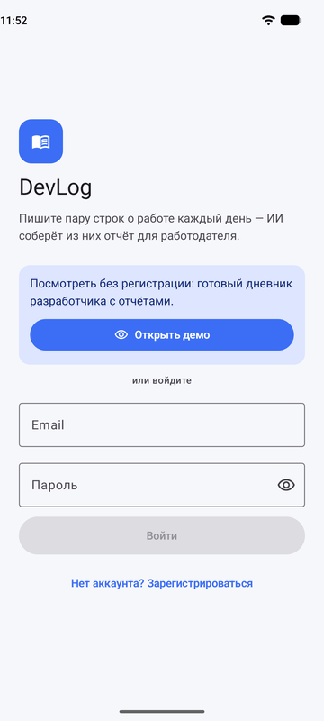
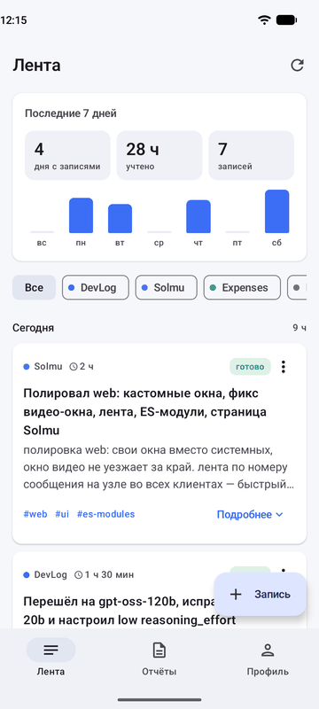
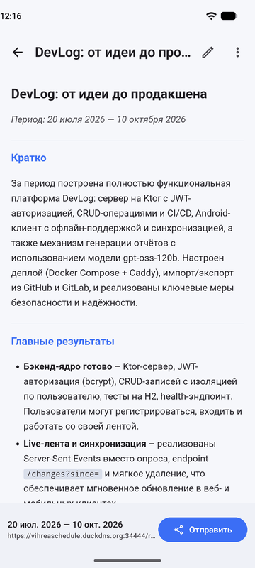
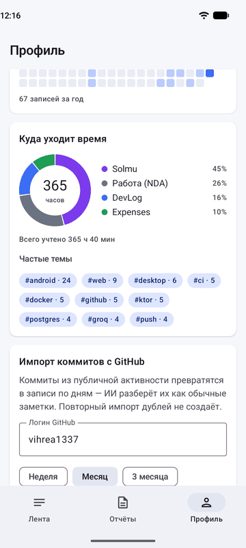
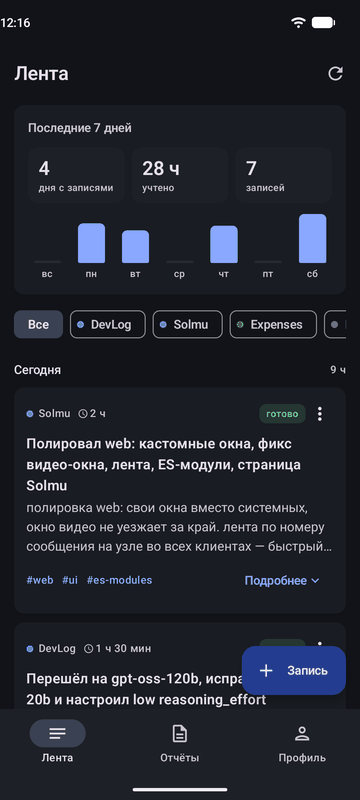
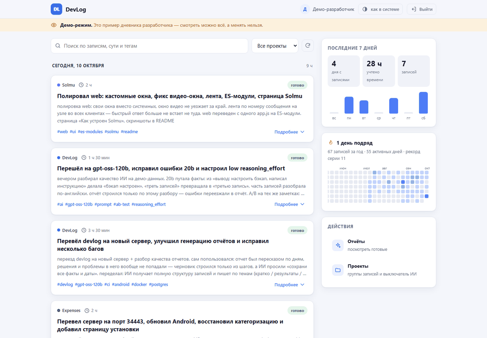
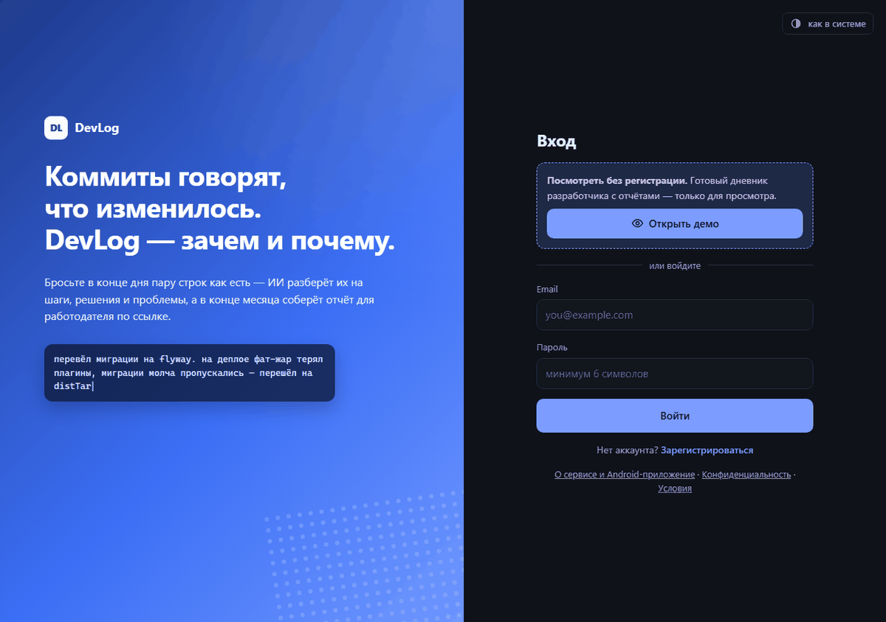
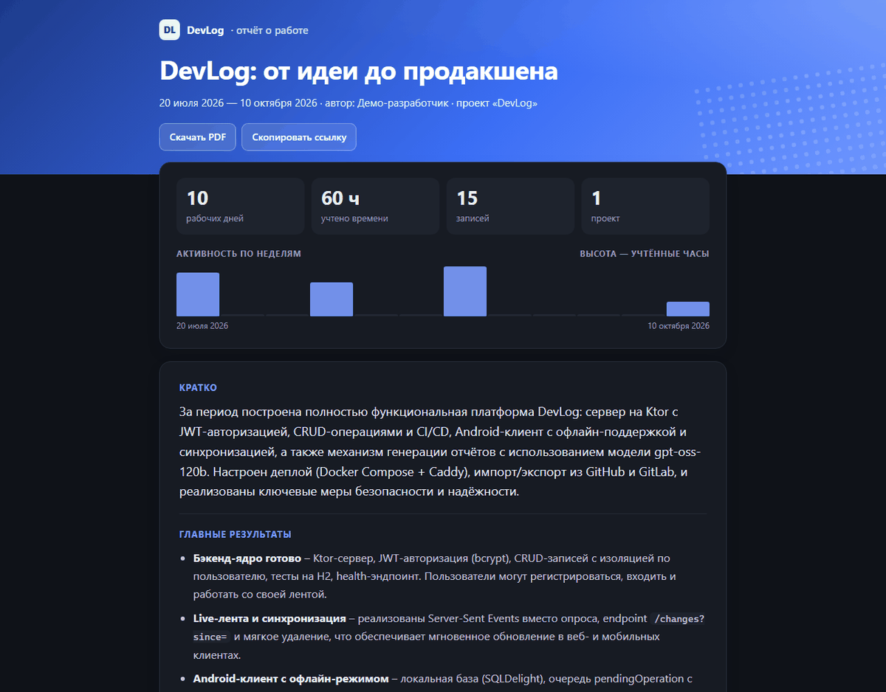

# DevLog — рабочий дневник разработчика

[](https://github.com/vihrea1337/devlog/actions/workflows/ci.yml)

**Коммиты говорят, что изменилось. DevLog — зачем и почему.**

В конце дня пишешь пару строк о работе как есть — ИИ разбирает их на шаги, решения и проблемы,
а в конце месяца собирает отчёт для работодателя: по темам, с цифрами и хронологией, по ссылке
без регистрации. Веб-приложение, Android-приложение и сервер — один автор, один репозиторий.

**Попробовать:** [открыть демо](https://vihreaschedule.duckdns.org:34444/) (кнопка «Открыть демо» — без
регистрации, только просмотр) · [пример отчёта](https://vihreaschedule.duckdns.org:34444/demo) ·
[Android-приложение (APK)](https://vihreaschedule.duckdns.org:34444/install.html)

<p align="center">
  
  
  
  
  
</p>

<p align="center">
  
</p>

<details>
<summary>Ещё: экран входа в вебе и публичная страница отчёта</summary>

<p align="center">
  
  
</p>
</details>

## Как это работает

1. **Заметка** — пишешь (или надиктовываешь) свободным текстом, что сделал за день.
2. **ИИ структурирует** её в фоне: суть, шаги, принятые решения, проблемы, итог, теги
   (строгий JSON, статусы `в очереди → обрабатывается → готово`).
3. **Отчёт за период** пишет ИИ **по темам, а не по дням**: кратко, главные результаты,
   ключевые решения, сложные проблемы. Цифры периода и хронологию считает код —
   чтобы модель не выдумывала числа. Отчёт можно поправить и отправить ссылкой.

## Android-приложение

Kotlin + Jetpack Compose (Material 3), minSdk 26, targetSdk 36, release-сборка с R8 (~2 МБ).

| Что | Как сделано |
|-----|-------------|
| Архитектура | MVVM: экран (Compose) → `ViewModel` (`StateFlow` состояния, `Channel` разовых событий) → репозиторий-интерфейс → сеть/база |
| DI | Hilt, включая `@HiltViewModel` и `@HiltWorker` |
| Навигация | Navigation Compose с типобезопасными маршрутами (`@Serializable`) |
| Офлайн-first | Лента читается из локальной базы (SQLDelight); создание, правка и удаление пишутся сразу в базу и в очередь операций, на сервер уходят при появлении сети |
| Синхронизация | Дельта-протокол `GET /api/entries/changes?since=` по монотонному `sync_seq`; конфликты — last-write-wins по `updatedAt`; гонки «удалили, пока создание летит по сети» закрыты |
| Фон | WorkManager: синхронизация с условием «есть сеть» (переживает закрытие приложения и перезагрузку, повтор с backoff), вечернее напоминание |
| Общий код | Модуль `shared/` (DTO API, SQLDelight-схема, клиент синхронизации на Ktor Client) — один контракт для сервера и клиента: поле поменялось — оба не скомпилируются, пока не поправишь |
| Остальное | Демо-вход «только просмотр», голосовой ввод (`RecognizerIntent`), сводка недели и диаграмма времени на Canvas, тёмная тема, DataStore для настроек |
| Тесты | Юнит-тесты ViewModel и расчётов (JUnit, kotlinx-coroutines-test, Turbine), UI-тесты Compose (`createComposeRule`) + тесты синхронизации в `shared/` |

## Возможности

- 🔐 **Аккаунты и изоляция** — JWT, bcrypt; каждый видит только своё.
- 🤖 **ИИ-структуризация** записей (Groq, `gpt-oss-120b`) — в фоне, очередью в базе, с суточным лимитом
  на пользователя; ответ 429 от ИИ-сервиса не теряет записи — очередь ждёт `retry-after`.
- 📊 **Отчёты** — текст по темам, точные цифры от кода, правка перед отправкой, публичная ссылка
  `/r/{token}` (отзываемая) с обложкой, графиком активности и превью для мессенджеров; PDF печатью.
- 🗂 **Проекты** — фильтр ленты; **выключатель ИИ по проекту** для работы под NDA (такие записи
  никогда не уходят во внешний сервис — ни при разборе, ни при сборке отчёта).
- 🔗 **Импорт** — коммиты GitHub (в т.ч. приватные, токен зашифрован AES-GCM) и GitLab, текстовые логи;
  **экспорт отчёта** в `docs/devlog.md` репозитория.
- 👀 **Демо-режим** — вход без регистрации в готовый дневник; сервер сам запрещает любые изменения (403).
- 🌐 **Веб** — одностраничное приложение, которое отдаёт сам бэкенд; живые обновления по SSE.

## Стек

| Слой | Технологии |
|------|-----------|
| Бэкенд | Kotlin, Ktor 3, Exposed, HikariCP, Flyway |
| База | PostgreSQL 16 |
| Android | Kotlin, Jetpack Compose, Hilt, WorkManager, Navigation, SQLDelight, Retrofit, Ktor Client, DataStore |
| ИИ | Groq (OpenAI-совместимый API) |
| Веб | HTML/CSS/JS без фреймворков |
| Деплой | Docker Compose, Caddy (HTTPS через DuckDNS) |
| CI/CD | GitHub Actions: тесты бэкенда и Android, сборка APK, смоук-тест Docker-образа на настоящем Postgres (миграции + сквозной API); релиз по тегу, деплой по кнопке |

## Запуск локально

Нужны JDK 21 и Docker.

```bash
# 1. Поднять базу
docker compose -f backend/docker-compose.yml up -d      # Postgres на порту 5433

# 2. (по желанию) ключ Groq для ИИ — иначе записи просто останутся «в очереди»
#    backend/secrets.properties:  groq.api.key=ВАШ_КЛЮЧ

# 3. Запустить сервер
cd backend && ./gradlew run                              # http://localhost:8080

# Android-приложение: по умолчанию смотрит на боевой сервер; на свой локальный —
# через параметр сборки (10.0.2.2 — так эмулятор видит компьютер; HTTP разрешён только в debug)
cd androidApp && ./gradlew :app:assembleDebug -Pdevlog.baseUrl=http://10.0.2.2:8080/
```

## Тесты

```bash
cd backend && ./gradlew test :shared:test     # 181 тест бэкенда (на встроенной H2) + 27 тестов общего модуля
cd androidApp && ./gradlew :app:testDebugUnitTest   # 17 юнит-тестов Android
cd androidApp && ./gradlew :app:connectedDebugAndroidTest   # UI-тесты Compose — на эмуляторе или телефоне
```

## Деплой

Docker (Postgres + Ktor + Caddy) — пошаговый runbook в [`deploy/server/README.md`](deploy/server/README.md).

## Дорожная карта

- ✅ **Фаза 1** — MVP: веб, аккаунты, записи, ИИ-структуризация, отчёты.
- ✅ **Фаза 2** — качество: деплой, CI, проекты, PDF, тёмная тема, поиск, календарь активности.
- ✅ **Фаза 3** — Android: лента, проекты, отчёты, офлайн-first, общий модуль `shared/`.
- ✅ **Фаза 4** — импорт GitHub/GitLab/текстовых логов, экспорт отчёта в GitHub.
- ✅ **Октябрь 2026** — отчёты по темам, Android 1.3 (Hilt, WorkManager, демо-режим, голосовой ввод),
  новый веб, публичная страница отчёта.
- ⏳ **Дальше** — импорт в Android-приложении, удаление аккаунта самим пользователем,
  iOS/Desktop из общего Kotlin-кода (Compose Multiplatform).

История изменений — [`CHANGELOG.md`](CHANGELOG.md), модель безопасности — [`SECURITY.md`](SECURITY.md),
архитектура и схема данных — в [`docs/`](docs/).
